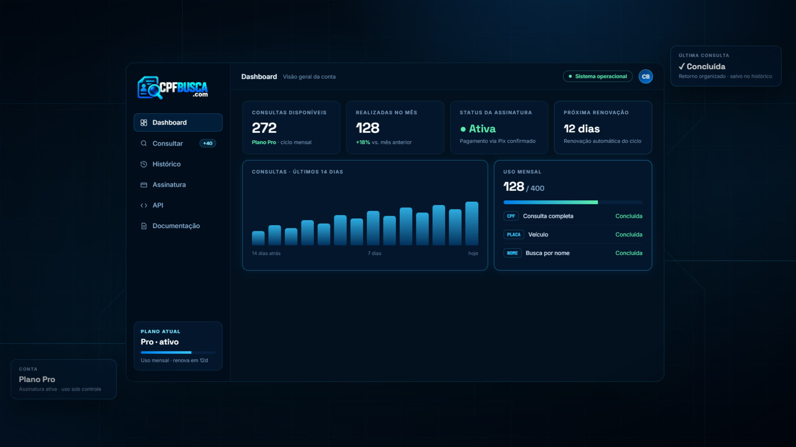

# 🔎 CPF Busca — cpfbusca.com

### Informação segura, em um só lugar.

---

## Sobre

O **CPF Busca** é uma plataforma privada de consultas com **painel premium**, **histórico organizado**, **assinatura mensal via Pix** (liberação automática após a confirmação) e **API completa** para integração. São **mais de 40 módulos**: CPF completo, nome, telefone, placa, chassi, CNPJ, endereço/CEP, parentes, vizinhos, score, fotos, título de eleitor e mais.

## Planos

| Painel | Valor | API | Valor | Limite |
|---|---:|---|---:|---:|
| Start | R$30/mês | API Start | R$30/mês | 20 req/min |
| Pro ⭐ | R$50/mês | API Plus | R$50/mês | 60 req/min |
| Elite | R$100/mês | API Pro | R$100/mês | 250 req/min |
| | | API Scale | R$300/mês | 1.000 req/min |

## Repositórios relacionados

- 🎬 Vídeo hero/motion do produto: repositório `cpfbusca-hero-motion`
- 💻 Exemplos de integração: repositório `cpfbusca-api-exemplos`

## Segurança e uso responsável

Sessões autenticadas, 2FA, logs de atividade e regras antiabuso. Utilize apenas para finalidades autorizadas e legítimas. Nunca publique tokens ou dados pessoais reais.

## Site oficial

👉 **https://cpfbusca.com/** · Suporte oficial no Telegram (link no site)
